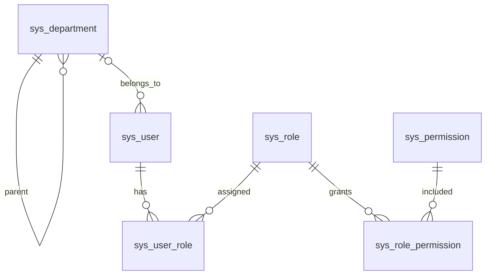
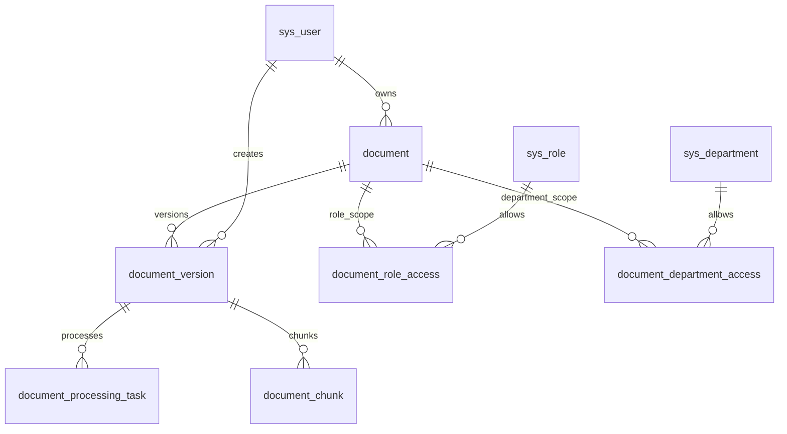
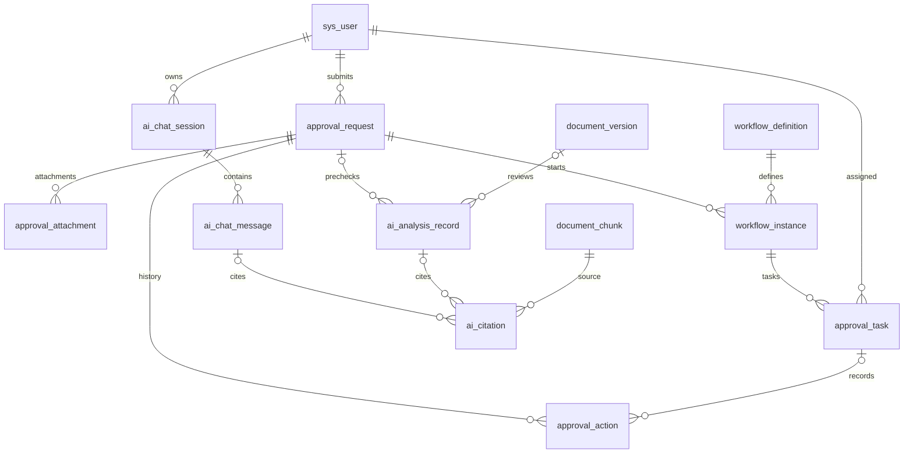

# 数据库基础设计

阶段 1 数据库采用 MySQL 8.0+、InnoDB 和 utf8mb4。建表以 `backend/src/main/resources/db/migration/V1__foundation_schema.sql` 为准，基础角色与权限种子以 V2 为准。Flyway 自动维护迁移历史；V1/V2 一旦应用，不应修改，新增结构变化使用更高版本迁移。

## 设计边界

本阶段实现用户 CRUD，其他表提供后续模块的初始数据关系，不代表对应功能已实现。工作流表保存业务元数据，不替代 Flowable 引擎表；文档发布、审批状态、AI 引用的完整业务校验将在相应模块实现。

统一使用自增 BIGINT 主键，金额使用 DECIMAL(18,2)，元数据使用 JSON。操作时间为 DATETIME(6)，运行环境统一为 Asia/Shanghai。用户软删除；引用历史不使用级联删除。用户名按数据库默认排序规则去重，不能复用已删除用户名。

## 身份与组织 ER

| 表 | 核心字段与约束 |
| --- | --- |
| sys_department | 部门编码唯一，自关联 parent_id，部门名称 |
| sys_user | username 唯一；password_hash 不返回；department_id 外键；enabled 与 deleted_at 独立 |
| sys_role | code 唯一；ADMIN、LEGAL、EMPLOYEE 元数据 |
| sys_permission | code 唯一；用户、文档、申请与审查权限定义 |
| sys_user_role | 联合主键 user_id、role_id，支持多角色 |
| sys_role_permission | 联合主键 role_id、permission_id |

V2 仅插入角色、权限及其关联，不创建账号或默认密码。阶段 1 新建用户关联 EMPLOYEE，但这些业务角色尚不参与临时管理员认证。

## 文档与检索 ER

| 表 | 核心字段与约束 |
| --- | --- |
| document | 逻辑制度身份、知识域、owner_id、current_version_id、删除时间 |
| document_version | 文件存储键、SHA-256、版本号、生效区间；发布状态和处理状态分离 |
| document_role_access | 文档与角色访问关联 |
| document_department_access | 文档与部门访问关联 |
| document_processing_task | task_key 唯一用于幂等；任务类型、状态、尝试次数、错误码 |
| document_chunk | version_id 与 chunk_index 唯一；页码、章节、文本、模型与外部向量键 |

版本号在同一逻辑文档内唯一。`document(id,current_version_id)` 通过复合外键关联 `document_version(document_id,id)`，防止当前版本指向其他文档。指针允许空值，发布模块必须额外校验 READY、PUBLISHED、有效时间与权限。

无访问范围配置时后续模块应按默认拒绝设计，不能推断为全员可见。向量内容不存入 MySQL，MySQL 维护可重建的文本块与索引状态。Word 页码不能可靠确定时允许为空，引用章节或段落。

## 申请 审批与 AI ER

| 表 | 核心字段与约束 |
| --- | --- |
| workflow_definition | code 与 version_no 唯一；配置 JSON、发布状态、可选外部引擎键 |
| approval_request | 申请人、类型、金额币种、内容 JSON、内容版本和状态 |
| approval_attachment | 关联申请与内容版本，文件存储键、散列和大小 |
| workflow_instance | 固定定义版本和申请快照，允许退回重提形成多次实例 |
| approval_task | 节点、处理人、状态、lock_version，为后续并发控制预留 |
| approval_action | 申请、可选任务、操作者、动作、前后状态、意见和时间 |
| ai_analysis_record | 申请预审或文档审查二选一；申请内容版本、模型、风险和结果 JSON |
| ai_chat_session | 用户与会话 |
| ai_chat_message | USER 或 ASSISTANT 消息、内容、模型和时间 |
| ai_citation | 消息或分析记录二选一；关联文本块，保留引用片段 |

分析目标与引用归属采用 CHECK 约束。外键保证引用文本块存在；后续引用模块仍须校验实际检索来源、访问权限和版本有效性。申请版本、附件版本和快照之间的一致性由后续服务校验。

## 索引与迁移策略

- 用户：用户名唯一、部门与启用状态、未删除用户分页索引。
- 文档：知识域与删除时间、有效发布区间、文档内版本号唯一。
- 解析：幂等 task_key 唯一、任务状态与更新时间。
- 审批：申请人与状态时间、处理人待办、申请操作历史。
- 问答：用户会话与会话内消息顺序。
- 所有关联表保留主键和必要反向索引；查询计划与额外索引按后续真实查询优化。

Flyway 禁止 clean，非空数据库不自动 baseline。迁移失败先诊断，不跳过校验。MySQL DDL 不能依赖事务回滚；在空库验收并备份后迁移，失败时明确检查部分创建状态，避免盲目重跑或破坏已有数据。
