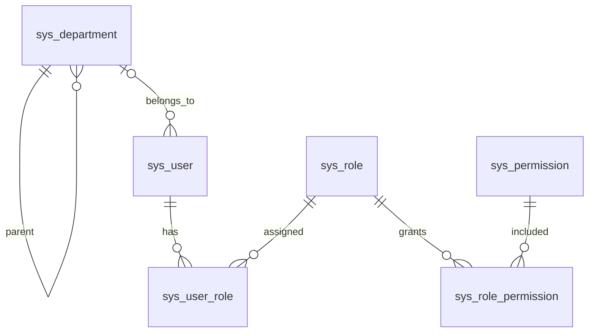
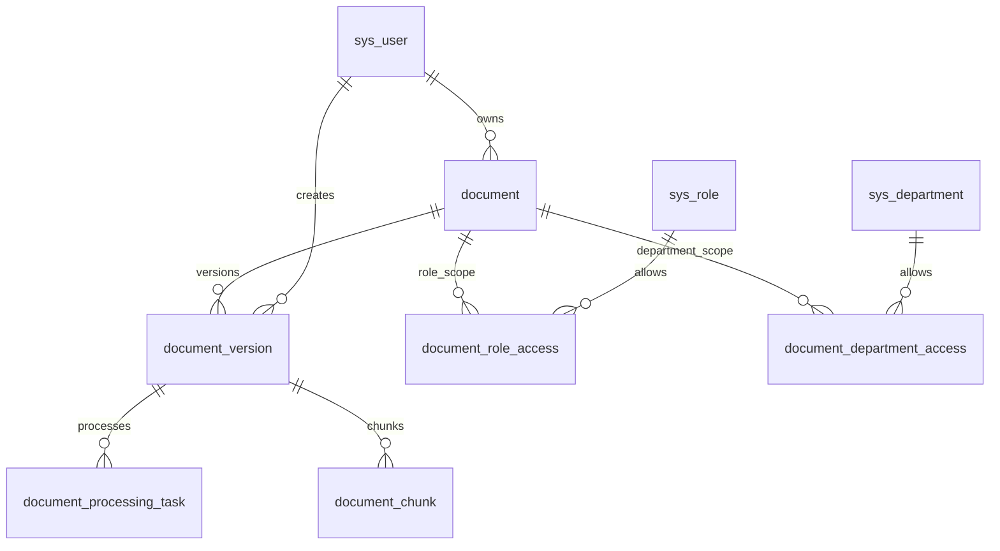
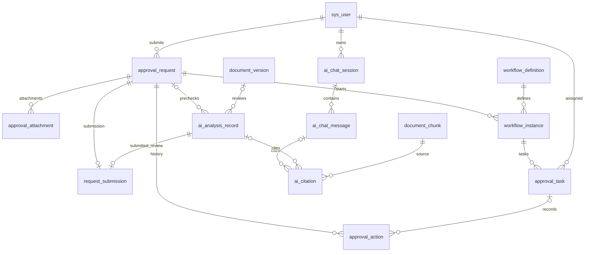

# 数据库基础设计

阶段 1 数据库采用 MySQL 8.0+、InnoDB 和 utf8mb4。建表以 `backend/src/main/resources/db/migration/V1__foundation_schema.sql` 为准，基础角色与权限种子以 V2 为准。Flyway 自动维护迁移历史；V1/V2 一旦应用，不应修改，新增结构变化使用更高版本迁移。

## 设计边界

本阶段实现用户 CRUD，其他表提供后续模块的初始数据关系，不代表对应功能已实现。工作流表保存业务元数据，不替代 Flowable 引擎表；文档发布、审批状态、AI 引用的完整业务校验将在相应模块实现。

阶段更新：阶段 4 已实现制度文档、不可变版本、授权下载、发布/停用、范围编辑和审计。解析任务、OCR、向量服务、审批流和 AI 引用仍按后续阶段实现。

统一使用自增 BIGINT 主键，金额使用 DECIMAL(18,2)，元数据使用 JSON。操作时间为 DATETIME(6)，运行环境统一为 Asia/Shanghai。用户软删除；引用历史不使用级联删除。用户名按数据库默认排序规则去重，不能复用已删除用户名。

## 身份与组织 ER

| 表 | 核心字段与约束 |
| --- | --- |
| sys_department | 部门编码唯一，自关联 parent_id，部门名称 |
| sys_user | username 唯一；password_hash 不返回；department_id 外键；enabled 与 deleted_at 独立 |
| sys_role | code 唯一；ADMIN、LEGAL、EMPLOYEE 元数据 |
| sys_permission | code 唯一；用户、文档、申请与审查权限定义 |
| sys_user_role | 联合主键 user_id、role_id，支持多角色 |
| sys_role_permission | 联合主键 role_id、permission_id |

V2 仅插入角色、权限及其关联，不创建账号或默认密码。阶段 1 新建用户关联 EMPLOYEE，但这些业务角色尚不参与临时管理员认证。

## 文档与检索 ER

| 表 | 核心字段与约束 |
| --- | --- |
| document | 逻辑制度身份、知识域、owner_id、current_version_id、删除时间 |
| document_version | 文件存储键、SHA-256、版本号、生效区间；发布状态和处理状态分离 |
| document_role_access | 文档与角色访问关联 |
| document_department_access | 文档与部门访问关联 |
| document_processing_task | task_key 唯一用于幂等；任务类型、状态、尝试次数、错误码 |
| document_chunk | version_id 与 chunk_index 唯一；页码、章节、文本、模型与外部向量键 |

版本号在同一逻辑文档内唯一。`document(id,current_version_id)` 通过复合外键关联 `document_version(document_id,id)`，防止当前版本指向其他文档。指针允许空值，发布模块必须额外校验 READY、PUBLISHED、有效时间与权限。

无访问范围配置时后续模块应按默认拒绝设计，不能推断为全员可见。向量内容不存入 MySQL，MySQL 维护可重建的文本块与索引状态。Word 页码不能可靠确定时允许为空，引用章节或段落。

阶段 4 的读取范围要求角色至少命中一个；若配置部门则同时命中部门，未配置部门表示不限制部门，缺少角色范围仍拒绝。治理权限为 `document:manage` 且本人 owner_id 或 ADMIN，治理人员可读取所管理制度的草稿。普通读者仅能读取曾发布的版本，历史读取重新校验最新范围。

当前有效查询要求逻辑文档未删除、指向该版本、PUBLISHED、READY、处于有效期，以及存在文本块且全部 INDEXED，文本、向量键和 Embedding 标识非空。发布使用逻辑文档行锁协调并发，旧版 RETIRED 并将块索引标记 INACTIVE；停用与删除清空 current_version_id。自然过期通过每次查询的时间过滤即时排除，不需要提前修改状态。未来向量检索与缓存必须复用这些条件，不能仅按向量库内容判定可见性。

## 申请 审批与 AI ER

| 表 | 核心字段与约束 |
| --- | --- |
| workflow_definition | code 与 version_no 唯一；配置 JSON、发布状态、可选外部引擎键 |
| approval_request | 申请人、类型、金额币种、内容 JSON、内容版本和状态 |
| approval_attachment | 关联申请与内容版本，文件存储键、散列和大小 |
| request_submission | 唯一 request_id、提交内容版本、表单/附件快照、analysis_id、提交时间 |
| workflow_instance | 固定定义版本和申请快照，允许退回重提形成多次实例 |
| approval_task | 节点、处理人、状态、lock_version，为后续并发控制预留 |
| approval_action | 申请、可选任务、操作者、动作、前后状态、意见和时间 |
| ai_analysis_record | 申请预审或文档审查二选一；申请内容版本、模型、风险和结果 JSON |
| ai_chat_session | 用户与会话 |
| ai_chat_message | USER 或 ASSISTANT 消息、内容、模型和时间 |
| ai_citation | 消息或分析记录二选一；关联文本块，保留引用片段 |

分析目标与引用归属采用 CHECK 约束。外键保证引用文本块存在；后续引用模块仍须校验实际检索来源、访问权限和版本有效性。申请版本、附件版本和快照之间的一致性由后续服务校验。

## 索引与迁移策略

阶段 8 新增 V8：approval_attachment 扩展 content_type、deleted_at，request_submission 以唯一 request_id 固定内容版本、snapshot_json 与预审 analysis_id，现共 28 张业务表。复用 approval_request 的 TRAVEL/DRAFT/SUBMITTED、ai_analysis_record 的结构化结果与全部检索依据快照、approval_action 的 SUBMIT 审计。修改表单或附件锁定申请并增加 content_version、旧分析 STALE；附件 content_version 表示加入时的版本，当前集合以未移除记录为准。提交同事务核对当前版本/最新预审/规则/来源并保存活动附件集合，重复提交受状态和唯一键约束。历史引用不使用 ai_citation 的 chunk 外键，保留快照并实时复查全部来源权限。V1–V7 不变；阶段九工作流表尚未投入此业务。

阶段 7 新增 V7：policy_question 保存 user_id、question、status、answer、全部 evidence_json 快照、citation_ids_json、生成/Embedding 模型、耗时与错误类型，用户/ID 索引用于本人历史游标分页，现共 27 张业务表。V1–V6 保持不变。问答使用单次记录，不启用 V1 预留的多轮 ai_chat_session/message/citation 表。引用采用原文快照，保留版本、当时块 ID、定位与偏移；不以可重建 chunk 的外键作为历史唯一依据，避免阶段六重建删除块破坏历史。历史展示按实时制度范围检查全部快照，旧版仍有权限时标记过时，无权或删除则隐藏整段答案。后续若使用预留 ai_citation 表，必须额外处理其 chunk 外键的保留策略。

阶段 6 新增 V6：document_chunk 增加 source_index/source_location/start_offset/end_offset，保留来源及原文 UTF-16 偏移；document_version 增加 index_generation。新增 document_index_run，以版本为主键保存当前代次、PROCESSING/SUCCEEDED/FAILED、尝试次数、错误、租约和模型，现共 26 张业务表。索引代次使用 UUID，向量键逐块生成 UUID，成功响应校验后同事务保存块、运行状态和 READY；重建前旧块 INACTIVE，失败保持 PARSED，重试使用新代次，迟到结果不能启用。V1–V5 不改动。

MySQL 文本和角色/部门关联是业务事实，Qdrant 本地目录是可重建索引。检索只查询成功索引代次、当前发布版本、有效时间和实时范围；先在向量库按授权键过滤，再从 MySQL 二次授权取正文。旧版、删除、停用和范围变更逻辑失效立即作用于下次查询。旧向量仍物理保留，垃圾回收后续实现。索引重建目前替换该版本的块记录，阶段七建立引用保存前必须增加保留已引用块的策略，不能删除已有引用外键目标。

阶段 5 新增 V5：document_version.processing_status 增加 PARSED（正文完成，尚未索引）；document_processing_task 增加 run_token、lease_until、parser_version。解析任务使用唯一 task_key=parse:{versionId}，重试复用同一任务，运行令牌防止旧结果覆盖新尝试。新增 document_parse_source，版本/source_index 唯一，保存真实页码或段落定位、章节、正文、提取方式、置信度和警告；DOCX 的 page_number 为空。现共 25 张业务表。来源不直接写入 document_chunk，也不填充假向量键；后续阶段六从来源切片和索引。V1–V4 保持不变，成功正文与任务状态同事务提交，软删除后来源保留但不开放访问。

阶段 4 新增 V4 迁移：document_version.published_at 记录实际发布时间，document_audit 保存文档、可选版本、操作者、动作、JSON 明细和时间。版本复合外键确保审计引用属于同一制度，现共 24 张业务表。V1–V3 保持不变，支持从 V3 增量升级；删除制度不级联清理版本、文件和审计。普通业务接口不提供已删除制度审计查询，数据保留供后续受控审计工具使用。

阶段 2 新增 V3 迁移 `auth_session`，现共 23 张业务表。`session_id` 是 UUID 主键并作为 JWT 的 `jti`；`user_id` 外键关联用户，`created_at`、`expires_at`、`revoked_at` 记录创建、到期与撤销。用户/撤销/到期组合索引用于会话查询，到期索引用于后续清理。数据库不保存完整 JWT。每次请求同时验证签名、到期时间、会话和账号状态；权限从现有 RBAC 表即时读取。V1/V2 保留原样，已有阶段 1 数据库通过 V3 增量升级。

- 用户：用户名唯一、部门与启用状态、未删除用户分页索引。
- 文档：知识域与删除时间、有效发布区间、文档内版本号唯一。
- 解析：幂等 task_key 唯一、任务状态与更新时间。
- 审批：申请人与状态时间、处理人待办、申请操作历史。
- 问答：用户会话与会话内消息顺序。
- 所有关联表保留主键和必要反向索引；查询计划与额外索引按后续真实查询优化。

阶段九新增 V9：workflow_publication 保存 TRAVEL 的当前发布指针并作为版本分配/选择共享行锁，现共 29 张业务表。workflow_definition 复用不可变发布版本；workflow_instance.route_json 保存启动时匹配的有序单人路线，唯一 (request_id,request_content_version)；approval_task.node_index 和唯一 (instance_id,node_index) 防止重复节点。request_submission 的 request_id 唯一改为 (request_id,content_version) 唯一，退回重提保留所有快照与预审编号。实例结束记录 ended_at，任务处理/取消增加 lock_version。没有改变 V1–V8；旧 SUBMITTED 不自动套用当前流程，可撤回后重新编辑/预审/提交。已有预留实例不自动转换，升级前需核对新增唯一约束是否存在冲突。接口与边界见 [阶段九说明](阶段9接口与权限说明.md)。

Flyway 禁止 clean，非空数据库不自动 baseline。迁移失败先诊断，不跳过校验。MySQL DDL 不能依赖事务回滚；在空库验收并备份后迁移，失败时明确检查部分创建状态，避免盲目重跑或破坏已有数据。

## 阶段十增量：任务 outbox 与工作账本

V10 新增 document_async_job：document_id/version_id 外键、PARSE/INDEX 类型、唯一 task_key、不可变 payload_json、状态与累计次数、投递 message_token、消费 run_token、租约及下次尝试/确认时间。业务任务与 job 加入同一事务，发送在提交后执行；发布 confirm 失败保留待投递记录，最多五次业务尝试。索引 payload 保存 generation 和稳定 vector keys，失败重试复用；历史代次不可激活新索引。监控接口不输出 payload 或令牌。Redis 不作为数据库事实来源；授权/版本仍在 MySQL 检查，cache namespace 必须按数据库隔离。详见[阶段十说明](阶段10接口与运维说明.md)。
